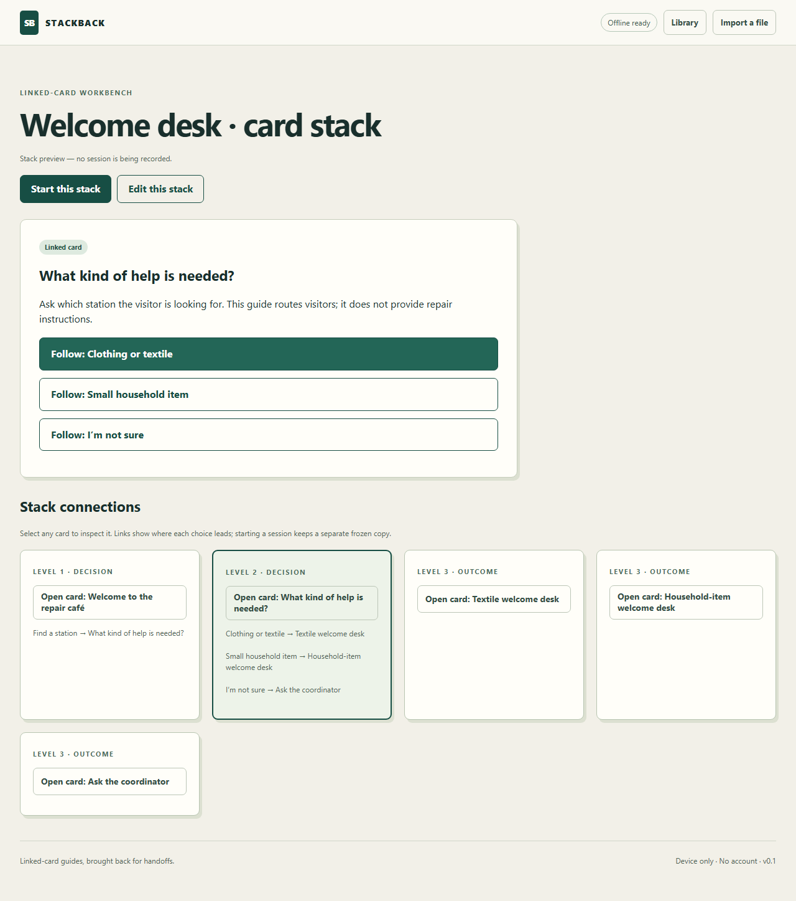
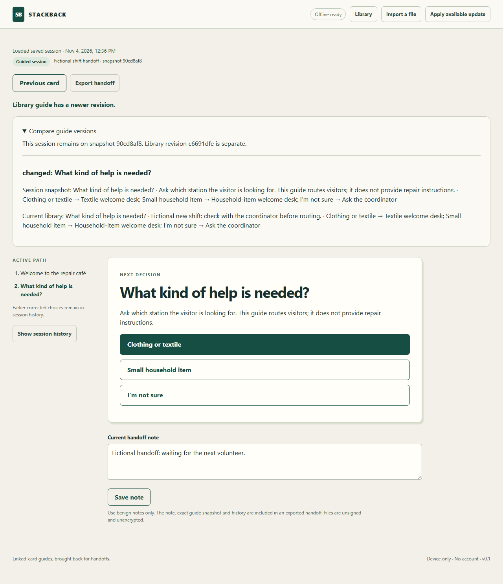

# StackBack
Linked-card guides, brought back for volunteer handoffs.

StackBack is a local web prototype for authoring a branching guide, following it, correcting a choice, saving your place and transferring the exact context in a portable file. The original fictional repair-café welcome guide demonstrates routing to a station. It does not give repair or safety advice.

For a shift change, the next volunteer needs the waiting task, the choices already corrected and the instructions that were used. **Practice a shift change** creates an unsaved fictional guide to explore that situation with the normal editor and runner. Its desk assignment can change from Blue table to Green table while the earlier session retains its own version. The coordinator must confirm which instructions apply now; a frozen snapshot alone cannot do that.

[Open StackBack](https://vijay-v-bhoyar.github.io/StackBack/). The first visit needs a connection; wait for **Offline ready** before going offline. Browser data is specific to this origin and profile.

## Run locally
Use Node.js 26.4.0 and npm 11.17.0 (the verified development versions).
```sh
npm ci --ignore-scripts
npm run dev -- --port 4793 --strictPort
```
Open the displayed loopback URL. For the offline-capable production shell:
```sh
npm run build
npm run preview -- --port 4793 --strictPort
```
PowerShell users can use `npm.cmd` in place of `npm`. Development mode is not the offline acceptance target.

## Explore the revived card stack
Select **Explore stack** to browse the original linked cards and inspect their connections without recording a session. The editor’s **Card stack map** jumps directly to each card. If an author changes the library guide after a session starts, **Compare guide versions** shows the differences while the run retains its original snapshot.

[Resurrection rationale and a reproducible shift-change demonstration](RESURRECTION.md).





## Try the complete workflow
1. Start **Welcome desk**, choose **Find a station**, then a station. The sample is fictional.
2. Use **Previous card** to correct a choice. **Session history** retains earlier choices; the active path is separate.
3. Save a benign current note. Reload and choose **Resume session**.
4. **Export handoff**, open a fresh browser profile at the same running app, select **Import a file**, inspect the preview and **Import as new copy**. Continue from the same guide snapshot and context.
5. Edit a copy of a guide. Change a destination and validate. Incomplete drafts can be saved and reopened, but cannot start/export as runnable guides.
6. For offline use, wait for **Offline ready** in a production-served build before disabling the network and cold-reloading. The app verifies the actual cached shell and attempts repair if resources are missing. An initial uncached offline visit cannot work.

## Choose a handoff format

| Need | Export | Recipient needs |
|---|---|---|
| Read the current step, note, active path and correction history | **Export readable brief (.txt)** | A UTF-8 text viewer; StackBack does not need to be installed or prepared |
| Continue the branching session on its exact frozen guide | **Export handoff** (.json) | A running or previously prepared StackBack app; preview and import a distinct copy |
| Reuse or edit an authored guide | **Export guide** (.json) | StackBack's guide importer |

The readable brief is not runnable or importable and does not include later library updates. It labels unsaved work when the in-memory session differs from the last checkpoint. Both formats are editable, unsigned and unencrypted. They provide context, not authentication or confirmation of current instructions.

[Read an actual synthetic exported brief](assets/examples/shift-change-brief.txt) or [view it in a plain-text reader](assets/screenshots/readable-brief.png).

To try the concrete case, create and save the shift-change practice guide, start it and choose Textile desk. Go back and choose Ask coordinator, then save a made-up waiting-task note. Edit Card 3 in the library from Blue table to Green table, save and resume the earlier session. Compare the two versions, then export a readable brief. The brief keeps the earlier context; the JSON can resume it. No volunteer time saving or benefit has been measured.

Selected local guides and sessions can be deleted after confirmation. Deleting a library guide keeps existing session snapshots. A stale tab cannot delete a newer record or silently recreate a deleted guide. Export needed context before deleting; there is no global browser reset in the app.

## Local data and limits
No account, server database, runtime AI, telemetry or automatic file transmission. Data lives in this origin's IndexedDB and shell cache. Local browser/profile access can expose or modify it; exported files are editable, unsigned and unencrypted. Avoid sensitive notes. Browser clearing/eviction can remove data, so export backups.

Imports are bounded to 1 MiB, schema v1, 100 cards, six choices per card, 1000 history events and specified text limits. Structural IDs are 1–64 ASCII letters/digits/underscore/hyphen. A session cannot advance beyond the portable-file/history limits. Guides use explicit acyclic routes with terminal outcomes. No HyperCard binary or HyperTalk compatibility is provided.

A session's guide snapshot never follows later author edits. The version comparison makes library changes visible. Imports create distinct local copies. A stale session tab cannot replace newer stored work: keep its alternative as a new session copy. New saved sessions and imports must fit the canonical 1 MiB JSON limit. Older locally stored over-capacity records remain available for note-shortening recovery. A newer worker waits for an explicit update; save first. Save failure leaves in-memory work marked **Not saved**. Valid work can be exported; an invalid draft must remain open until it can be saved locally or corrected. Changing browser origins does not transfer data automatically.

Shell installation and repair bypass the browser's HTTP cache, and worker implementation changes receive a distinct shell cache identity. This prevents a new worker from preparing stale HTML that loads an older app. A regression using the exact deployed r6 files and a warm ten-minute HTTP cache verifies native activation, pending-note protection, persisted snapshot/history and offline reload against the corrected build.

If an older cached version still fails to update, save your work and export a JSON handoff, close all StackBack tabs, then reopen the public app. Close only after a successful save/export; otherwise keep the tab open and copy needed unsaved text. Keep the backup; it can be previewed/imported into the current version if needed. Do not clear browser storage as an upgrade step. The earlier failed upgrade observation is retained separately from the corrected-build regression; other browsers and every historical release have not been qualified.

## Verify
```sh
npm run typecheck
npm test
npm run build
npm run test:e2e
```
The browser suite starts its own production server on 127.0.0.1:4793, so stop another server on that port first. It uses isolated synthetic fixtures. Install the compatible Chromium binary once with `npx playwright install chromium` before running the browser suite.

Verification passed 22 unit/domain tests (including 300 generated cases) and 38 browser tests. Tests cover graph/replay/file boundaries, generated valid paths, durable recovery, safe import/export, readable text, duplicate copies, stale saves/deletion, failed-copy retry, quota/unavailable storage, offline reload/update with a warm HTTP cache, worker-only cache identity, literal hostile strings, stack browsing/version comparison, repository subpaths, responsive keyboard interaction and automated axe checks. Automated accessibility results do not establish real screen-reader usability or human acceptance.

The update fixture serves two real service-worker versions from a local HTTP server and verifies a marker from the activated replacement. This corrects the earlier interception-based fixture: Playwright cannot route requests for updated service-worker main scripts. Original assertions and the previous fixture were retained in the development evidence; generated replay seeds and domain tests are unchanged.

## Source layout
- `src/domain.ts`: schemas, graph validation, replay and portable-file limits.
- `src/storage.ts`: native IndexedDB transactions and guide/session conflicts.
- `src/stack.ts`: card-stack outline and semantic snapshot comparison.
- `src/brief.ts`, `src/practice.ts`: readable context export and original fictional shift-change guide.
- `src/main.ts`, `src/styles.css`: semantic Archive Workbench UI.
- `src/sample.ts`: original fictional sample.
- `src/sw-template.js`, `scripts/build-sw.mjs`: content-identified production shell cache.
- `src/domain.test.ts`, `tests/journeys.spec.ts`: domain and real-browser verification.

## Development and verification
Local verification is separate from hosted operation, independent human validation and contest qualification. A public narrated video has not been produced. This prototype is not represented as submission-ready or beta-validated.

Kiro IDE 1.4.86 (Auto) contributed in two bounded development tasks. First, the Default agent authored the replay-property requirements, design, tasks and model-based test, then corrected its invalid generator after a minimized counterexample. The [replay verification note](.kiro/specs/stackback-replay-properties/verification.md) records that contribution.

For durable handoffs, Kiro's Spec workflow read the always-included project steering and produced the design/task breakdown from Codex-authored requirements. The Default agent authored four browser regressions and implemented the canonical-size checks, recoverable stored-run reader and transactional session-conflict protection in `src/domain.ts` and `src/storage.ts`. Codex corrected fixture/oracle defects in the new tests, established four behavioral failures against the earlier build, integrated UI/worker and stack features, reviewed the changes and ran the passing checks. The [durable-handoff verification note](.kiro/specs/durable-handoffs/verification.md) separates authorship from execution. No Kiro hook, custom agent, MCP, power or standalone CLI contribution is claimed.

The later copy-retry/focus/update-state fixes, metadata display, readable brief, practice guide, local-record lifecycle and HTTP-cache compatibility correction were implemented and verified through Codex. The Kiro notes record the earlier bounded contributions; they do not attribute these later additions to Kiro.

The source is MIT licensed. Development tooling is pinned in the lockfile; its own licenses apply. No third-party media or legacy HyperCard assets are bundled.

